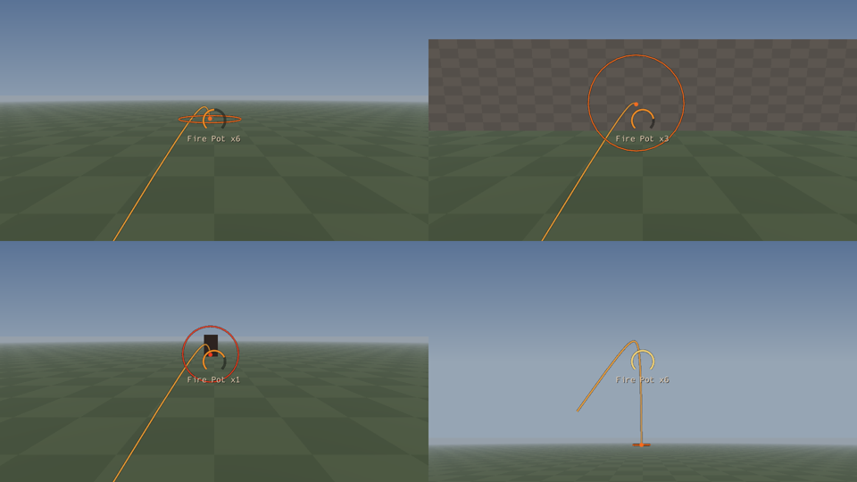

# Fire Pots

Throwable fire and frost pots for Skyrim SE/AE (SKSE plugin, CommonLibSSE-NG). Wind up a throw,
see exactly where it will land, and set the ground on fire.

**Controls**
- **Hold G** to wind up. The longer you hold (1 s to full), the farther it goes. While you hold,
  an arc shows the flight, a ring shows the blast radius where it lands (red when it will hit
  someone directly), and a meter under the crosshair shows the wind-up and how many pots you have.
- **Release G** to throw. Your weapon stays drawn; the pot leaves from your left hand.
- **Tap G** or **press block** to cancel without using a pot.
- **Press V** to switch between Fire Pots and Frost Pots. If you run out of one, the next throw
  switches to the other by itself.



The preview is the real drawing code (`ArcDraw.cpp`) run over arcs traced by the real arc math
(`Ballistics.h`) in a test scene (`arc_preview` target), not a mockup.

**What a pot does:** it flies as a real projectile on a ballistic arc and shatters on the first
thing it touches.
- **Fire Pot:** pottery-break and ignite sounds, a fire burst (30 fire damage in a 160-unit radius,
  resist fire applies, plus a small knock), a scorch mark and a patch of burning ground (vanilla's
  small long-burning fire hazard).
- **Frost Pot:** the same shatter with a frost burst (30 frost damage, which also drains stamina
  like frost spells) and a frost decal. No lingering patch.

## Crafting

At any cooking pot: **one empty container + a filling** makes one pot.

| Containers (any one) | Fire Pot fillings | Frost Pot fillings |
|---|---|---|
| Empty wine bottles (all four vanilla ones, the spiced wine bottle, Dawnguard's two) | Fire Salts, Dwarven Oil, Troll Fat (1 each) | Frost Salts, Ice Wraith Teeth (1 each) |
| Clay and Nordic jugs, small and large; glazed jug | Charred Skeever Hide, Spriggan Sap (2 each) | |
| Glazed and Nordic pots; glazed urn | Ash Creep Cluster, Ash Hopper Jelly, Burnt Spriggan Wood, Spawn Ash (2 each, Dragonborn) | |

The menu shows **one row per filling you carry**, so you choose what to spend; the container is
picked for you (the first one you carry, cheapest clutter first). Rows only appear once you carry
both an empty container and that filling.

For testing: `help "fire pot" 4` (or `"frost pot"`) in the console gives the ID, then
`player.additem <id> 10`.

## How it fits together

| Piece | Where | How |
|---|---|---|
| Pot items | `FirePots.esp` (`FP_FirePot`, `FP_FrostPot`) | Misc items, 1 lb |
| Recipes | `FP_Recipe<Type>_<Filling>_<NN>` | One per container × filling (187); conditions show one row per filling |
| Flight | `FP_FirePotProjectile` | Missile with gravity that explodes on contact; launched by the DLL from the throwing hand with the wind-up speed |
| Shatter + fire | `FP_FirePotExplosion` | Sounds, scorch decal, fire-damage burst (`FP_FirePotBurstEnch`), places vanilla `FireSmLongHazard` |
| Shatter + frost | `FP_FrostPotExplosion` | Sounds, frost decal, frost-damage burst (`FP_FrostPotBurstEnch`) |
| Wind-up, arc, launch | `src/Thrower.cpp` | Throw key input, per-frame update on the player, havok raycasts along the arc, `Projectile::Launch` |
| Arc math | `src/Ballistics.h` | Charge → speed, loft, angles, arc tracing, gravity fit (unit-tested) |
| Overlay | `src/ArcDraw.cpp`, `src/OverlayD3D.cpp` | ImGui on the swap chain's Present, same approach as DaggerfallCombat (they run side by side) |
| Models | `src/Forms.cpp` | Borrowed from vanilla at load (fire: GlazedPot01 + the falling oil-lamp trap's explosion; frost: small clay jug + the frost rune's explosion); `[Visuals]` in the INI swaps in a custom mesh |

**The arc learns the engine.** The preview starts from real-world gravity. On your first throw the
plugin follows the pot for half a second, fits its real gravity and launch speed, and corrects the
preview (and the launch speed) to match. The log shows it as `Flight check: ...`; put the measured
gravity in `fGravityUnits` to skip the learning.

## Getting a build without compiling

Every push builds on GitHub (Actions tab → latest **Build** run → *Artifacts*). Download
**FirePots-mod**: it contains `FirePots.esp` and `SKSE/Plugins/FirePots.dll` + `FirePots.ini`, so
install it directly in MO2 / Vortex. **FirePots-pdb** has debug symbols for crash logs.

## Requirements

- **SKSE** and **Address Library for SKSE Plugins** for your game version (Steam 1.7.104: SKSE
  2.3.1+, Address Library *All in One* v13+).
- `FirePots.esp` is ESL-flagged (takes no load order slot). Masters: Skyrim.esm, Dawnguard.esm,
  Dragonborn.esm (every SE/AE copy has them).
- Skyrim VR is not supported.

## Build (Windows)

Same toolchain as DaggerfallCombat: Visual Studio 2022 (*Desktop development with C++*), vcpkg with
`VCPKG_ROOT` set, Git. Then:

```
cmake --preset release
cmake --build --preset release
```

The DLL lands in `dist/SKSE/Plugins/`. Add `-DMOD_OUTPUT_DIR="C:/path/to/MO2/mods/Fire Pots"` to the
configure step to copy it into your mod folder on every build. The ESP is generated with
`dotnet run --project tools/MakePlugin -c Release -- <folder>` (CI does this).

Offline checks (no game needed; `ballistics_test` also builds with plain g++/clang):

```
cmake --build --preset release --target ballistics_test arc_preview
build\release\ballistics_test.exe
build\release\arc_preview.exe .
```

## Test checklist

Each step adds one thing. Log: `Documents/My Games/Skyrim Special Edition/SKSE/FirePots.log`.

**A. It loads**
1. Log shows `FirePots loaded`, `Hooked PlayerCharacter::Update`, `Input listener registered`,
   `Forms ready: ...`, `Pot model: '...'` with a real mesh path and `Overlay: arc preview installed`.

**B. Wind-up and arc**
2. With no pots, press G: "You have no Fire Pots or Frost Pots."
   At a cooking pot with an empty wine bottle and Fire Salts + Troll Fat: two Fire Pot rows. Drop
   the bottle: both rows disappear.
3. Add 10 pots. Hold G: the meter fills over about a second and an arc leaves your left hand.
   Look around while holding: the arc and ring follow. Aim at a wall: the ring stands up on it.
   Aim at an NPC: the ring turns red when the arc ends on them.
4. Tap G quickly: "Hold the throw key to wind up..." and no pot is used. Hold G and press block:
   "Throw cancelled", no pot used.
5. Add a few Frost Pots and press V: "Frost Pot (n)", and the arc turns blue. Throw them all; the
   next G switches back to Fire Pots by itself.

**C. The throw**
6. Release G after a full wind-up: the pot flies along the arc and shatters where the ring was,
   with sound, a flash of fire and a burning patch. One pot is gone.
7. Console/log shows `Threw a Fire Pot: ...` and, a moment later, `Flight check: gravity ...` and
   `Calibrated the arc: ...`. From the second throw on, the pot should land on the ring exactly.
8. Hit a bandit: fire damage and burning. Stand in the fire yourself: it hurts you too.
9. First person and third person both work; throws are blocked while riding or swimming.

## Known unknowns (only an in-game test can settle these)

- **Pitch sign of `Projectile::Launch`.** Assumed Skyrim's convention (positive = down). If it's the
  other way the first throw goes the wrong way vertically; the flight check detects it, flips it and
  logs a line. Please send me that log line if you see it.
- **Missile gravity.** Measured on the first throw (see above); if the log says `not enough flight
  to measure`, throw a longer one.
- **The borrowed models.** The glazed pot may look big in flight (`fProjectileScale`), and if the
  oil-lamp explosion's model turns out to be empty, set `sExplosionModel = Skyrim.esm|0439C0`
  (FireBallExp01).
- **No throw animation yet.** The pot just leaves the hand. Vanilla has no object-throw animation;
  one can be made with the DaggerfallCombat hkx tools and played when the pot is released.

## Next

- **Oil pots:** leave vanilla's oil puddle (`TrapOilHazard01`), ignited by any fire (spell, torch,
  fire pot, enchanted weapon) via a small ignition watcher in the DLL.
- **NPC grenadiers:** a keyword on some bandits / Forsworn; the DLL lets them throw with the same
  projectile code at mid range, leading the player's movement, with a cooldown and a pot count.
- **A proper model** (a small sealed clay pot) to replace the borrowed GlazedPot01.
- MCM page for the INI settings.
