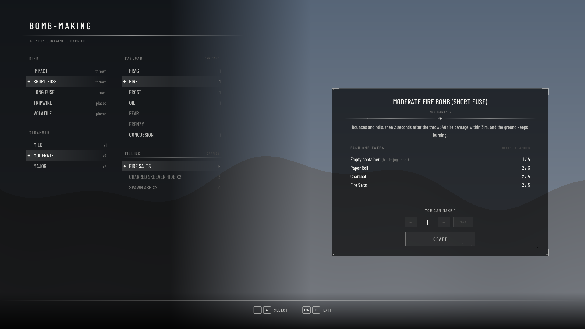

# Fire Pots

Craftable bombs for Skyrim SE/AE (SKSE plugin, CommonLibSSE-NG). Pick a trigger, a payload and a
strength; throw them with a wind-up, or set tripwires.

## Bombs

A bomb is **trigger × payload × strength**, and every combination is its own item
("Moderate Fire Bomb (Short Fuse)"): 4 triggers × 8 payloads × 3 strengths = 96 kinds. Every
description gives the numbers (damage, radius, duration).

| Trigger | What it does | Made with (per mild bomb) |
|---|---|---|
| Impact (thrown) | bursts on contact | 1 Fire Salts |
| Short fuse (thrown) | a real physics object: bounces, rolls, comes to rest; bursts 2 s after the throw | 1 Paper Roll, 1 Charcoal |
| Long fuse (thrown) | the same, bursts 4.5 s after the throw | 2 Paper Roll, 1 Charcoal |
| Tripwire (placed) | set down on the ground ahead of you; armed after 3 s, then bursts when anyone (you too) comes within ~1.7 m | a wire (Linen Wrap, Leather Strips or Leather) and an igniter (Fire Salts, Dwarven Gear or Dwarven Gyro) |

**Every bomb is volatile once it's lying in the world** — set down with a tap of G, dropped from
your pack, or a fuse bomb still rolling: a weapon, arrow, spell or another bomb's blast sets it
off, so they chain. Pick one up to disarm it (not a lit fuse bomb).

| Payload | What it does | Filling (any one, per mild bomb) |
|---|---|---|
| Frag | shrapnel: physical damage and a shove | Nails, Quarried Stone (Hearthfire) or a Soul Gem Fragment |
| Fire | fire damage and burning ground | Fire Salts; or 2 Charred Skeever Hide / Ash Creep Cluster / Burnt Spriggan Wood / Spawn Ash |
| Frost | frost damage that saps stamina, and slows | Frost Salts, Ice Wraith Teeth; or 2 Frost Mirriam |
| Oil | a slick (60 s) that slows anyone in it; a fire bomb bursting in it sets it ablaze | Dwarven Oil, Troll Fat; or 2 Ash Hopper Jelly |
| Smoke | a lingering cloud with a low mist under it: anyone inside is hidden (until they attack), loses stamina and gets no stamina regen | Charcoal; or 2 Tundra Cotton |
| Fear | a blinding flash; everyone up to level 10/20/30 flees | Ectoplasm, Glow Dust; or 2 Nightshade / Deathbell |
| Frenzy | everyone up to level 10/20/30 attacks whoever is nearest | Hagraven Feathers, Falmer Ear; or 2 Powdered Mammoth Tusk |
| Concussion | wide stagger (1.75× the radius), very loud | Void Salts, Briar Heart; or 2 Bone Meal |

| Strength | Ingredients | Effect |
|---|---|---|
| Mild | as listed | 2 m blast (concussion 3.5 m) |
| Moderate | 2× everything (not the container) | 3 m blast (5.3 m), double damage, longer effects |
| Major | 3× | 4 m blast (7 m), triple damage, longest effects |

**Prices** come from the ingredients: what the cheapest way to make it is worth, × 1.25
(`fValueMult`). **Making bombs trains Alchemy** like brewing does: each bomb gives its price as
Alchemy practice (`fAlchemyXPMult`).

Every bomb also takes **one empty container**: any empty wine bottle, clay or Nordic jug, glazed or
Nordic pot. It's picked for you. **Drinking wine gives its empty bottle back.**

**Getting bombs:** make them anywhere with **H**, or buy them: general goods merchants (fire, frag,
oil, tripwires), apothecaries (fire, frost, fear, frenzy), court wizards (concussion, fear,
frost). Bandits and Forsworn carry a few, and they're in the **random potion loot** (the list
chests, barrels and enemies draw potions from). All in `[Loot]`.

## Controls

- **H**: the bomb-making table, anywhere. Laid out like Skyrim's own crafting menus: lists on the
  left over a dark fade (kind, strength, payload, filling, with how many you could make or carry),
  and an item card on the right with the bomb, what one takes (needed / carried, red when short),
  how many you can make, an amount and **Craft**. The font is Barlow Condensed (SIL Open Font
  License, `SKSE/Plugins/FirePots/`); point `sMenuFont` at another .ttf to change it.
  The game pauses while it's up. Mouse, arrows/WASD or d-pad to choose; Enter/E/A to select;
  Esc/Tab/B or H to close. It always opens, so it's also the recipe book.
- **Bombs are scrolls**: Scrolls tab; buy, sell, stash, favorite and **equip to a hand**. With a
  bomb in a hand, **hold that hand's attack button** to wind up (the hand comes up like readying a
  spell) and **release** to throw (the spell-release motion). A tripwire is set down instead.
- **G**: hold to wind up, release to throw, without equipping anything (no hand animation).
  **Tap G** to set the bomb down where you're looking instead (a fuse bomb's fuse is lit).
- **V**: next kind of bomb you carry (swaps the one in your hand, if any).
- A full wind-up lands about 20 m away on flat ground. Bombs are 70% of the container's size
  (`fProjectileScale`).
- **Throw preview** (arc + landing ring, or a tripwire's trigger ring) is **off by default**; turn it
  on in the MCM. The small wind-up meter shows either way.



The picture is the real menu code (`CraftUI.cpp`) rendered offline with a made-up pack
(`craft_preview` target), not a mockup.

## Settings (MCM)

*Mod Configuration → Fire Pots* (SkyUI + MCM Helper): keys, throw speeds, wind-up time, loft,
tripwire reach, the preview, messages, crafting in combat, bottle return, merchants and loot.
Changes apply when you close the menu (merchants/loot on the next game start). Everything else
(ingredient lists, loot lists, models) is in `SKSE/Plugins/FirePots.ini`.

## Getting a build without compiling

Every push builds on GitHub (Actions tab → latest **Build** run → *Artifacts*). Download
**FirePots-mod**: it contains `FirePots.esp`, `Scripts/`, `MCM/` and `SKSE/Plugins/` (DLL + INI), so
install it directly in MO2 / Vortex. **FirePots-pdb** has debug symbols for crash logs.

## Requirements

- **SKSE** and **Address Library for SKSE Plugins** for your game version (Steam 1.7.104: SKSE
  2.3.1+, Address Library *All in One* v13+).
- `FirePots.esp` is ESL-flagged (takes no load order slot); its only master is Skyrim.esm.
- For the menu: **SkyUI** and **MCM Helper**. Without them everything works; you edit the INI instead.
- HearthFire's Nails and Quarried Stone are frag fillings; every SE/AE copy has HearthFire.
- Skyrim VR is not supported.

## Build (Windows)

Same toolchain as DaggerfallCombat: Visual Studio 2022 (*Desktop development with C++*), vcpkg with
`VCPKG_ROOT` set, Git. Then:

```
cmake --preset release
cmake --build --preset release
```

The DLL lands in `dist/SKSE/Plugins/`. Add `-DMOD_OUTPUT_DIR="C:/path/to/MO2/mods/Fire Pots"` to the
configure step to copy it into your mod folder on every build. The ESP is generated with
`dotnet run --project tools/MakePlugin -c Release -- <folder>` (CI does this).

Offline checks (no game needed; `ballistics_test` also builds with plain g++/clang):

```
cmake --build --preset release --target ballistics_test arc_preview
build\release\ballistics_test.exe
build\release\arc_preview.exe .
```

## Test checklist

Log: `Documents/My Games/Skyrim Special Edition/SKSE/FirePots.log`.

1. Log shows `FirePots loaded`, `96 of 96 bombs ready`, `Prices set for 96 bombs`, `Leveled
   lists: 25 entries added`, `Smoke cloud model ...`, `Frost burst model ...`, `Watching hits`,
   `menu font: Data/SKSE/Plugins/FirePots/MenuFont.ttf`, `Watching for MCM changes`. The MCM lists *Fire Pots* with three pages.
2. Press H: the game pauses and the bomb-making table opens with a cursor. With nothing in your
   pack every count is 0 and *Craft* is greyed; the right side still lists what each bomb takes.
3. With an empty wine bottle and 4 Fire Salts: *Impact*, *Mild*, *Fire* (can make 2), Craft: one
   "Mild Fire Bomb (Impact)", a bottle and 2 salts gone (one for the trigger, one for the filling).
   Esc closes it and the game resumes; moving and attacking work again.
4. Throw it with G: soft arc, bursts on contact, burning ground. With the preview on (MCM), the arc
   and a ring show while winding up.
5. A short-fuse frag bomb tumbles through the air, bounces and rolls, and bursts 2 s after the
   throw (log: `thrown as a physics object`, then `went off at`). You can't pick it up.
6. A tripwire (G, hold, release): it's set down a few steps ahead; a bandit walking over it sets it
   off. (Check whether walking over your own sets it off, and tell me.)
7. Oil then fire on the same spot: the slick slows; the fire bomb sets it ablaze (log: `Oil slick
   ... ignited`).
8. Tap G with any bomb: it's set down. Shoot it with an arrow: it bursts. Two side by side:
   hitting one sets off the other a beat later. Picking one up gives it back.
9. A tripwire: set it, wait 3 s, walk onto it: it goes off (so does an enemy walking onto it).
   Every payload but frag and concussion shows something (oil a pool, frost a swirl, fear a
   bright cloud, frenzy a dark one, smoke a cloud over a low mist).
10. Make a few bombs: the Alchemy bar moves (log: `Alchemy practice: ...`).
11. Fear / frenzy on a group of bandits; concussion staggers everything in a wide ring and is loud.
12. Equip a bomb to the left hand, hold right-click, release: the hand's release motion, the bomb
    flies. V swaps the bomb in the hand.

## Known unknowns (only an in-game test can settle these)

- **Borrowed looks** (`[Visuals]`): picked by name from vanilla forms, not seen in game yet; swap
  any line for an alternative listed next to it.
- **Fuse bombs' preview** shows the first bounce, not where they roll to.
- **Fuse bombs at 70% size**: the model shrinks, but the engine may keep the collision full size,
  so a resting jug can float a hair above the ground. `fProjectileScale = 1` if it bothers you.
- **Bombs in the world and hits**: they rely on the engine sending a hit event for a struck item
  lying in the world. Arrows and spells should; melee swings at clutter might not. Bombs bursting
  nearby always set them off (the mod checks that itself).
- **Oil only ignites from fire bombs**, not fire spells, torches or enchanted weapons yet.
- **Hand throws ride on a scroll cast** (0.3 s charge, an invisible do-nothing projectile); the
  mod launches the real bomb when it sees the scroll used up.

## To do

- A real overhand throw animation through Open Animation Replacer (needs your
  `Skyrim - Animations.bsa`).
- NPC bombers.
- Fire spells and torches igniting oil.
